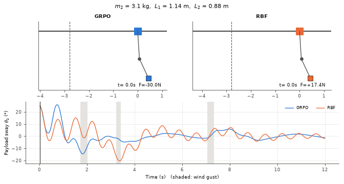
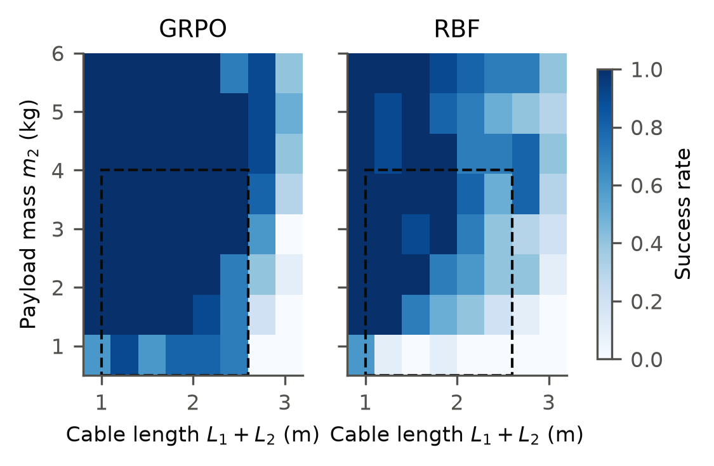
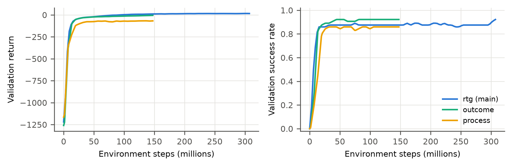

# RL-Based Anti-Sway Control of a Double-Pendulum Crane

**Team:** Rupesh (B24CM1052)

**GRPO for physical control.** A trolley must carry a hook and a payload (a double pendulum) to a target quickly while suppressing the coupled sway. The payload mass, cable lengths, initial sway and wind gusts are all randomized.

We adapt **Group Relative Policy Optimization (GRPO)** ([DeepSeekMath, arXiv:2402.03300](https://arxiv.org/abs/2402.03300)) from LLM training to continuous control:
- There is **no critic**.
- **G rollouts replay the same randomized scenario** on a **GPU-batched simulator** and act as each other's baseline.

The comparison baseline is the **RBF neural-network adaptive controller** of [Qiang et al., Front. Robot. AI 2021](https://www.frontiersin.org/journals/robotics-and-ai/articles/10.3389/frobt.2021.639734/full): a computed-traction law on a nominal model, plus an online-adapted RBF compensator.



## Results

These are held-out test scenarios, 100 per condition, and both controllers face the identical scenarios and gust schedules. An episode **succeeds** if the crane is settled during the final second: |e| < 5 cm, |θ| < 2° and |ẋ| < 5 cm/s.

| Condition | Success GRPO | Success RBF | Settling time GRPO | Settling time RBF | Max sway GRPO | Max sway RBF |
|---|---|---|---|---|---|---|
| Nominal | **100%** | 71% | **7.1 s** | 9.2 s | 29.8° | 24.8° |
| Random | **94%** | 62% | **7.1 s** | 8.8 s | 29.7° | 26.6° |
| Heavy payload (4 kg) | **100%** | 72% | **6.7 s** | 8.5 s | 26.9° | 24.0° |
| Light payload (0.5 kg) | **48%** | 23% | **9.0 s** | 9.3 s | 50.2° | 48.5° |
| Long cables (2.6 m) | **73%** | 31% | **8.9 s** | 10.5 s | 28.2° | 27.8° |
| Short cables (1.0 m) | **100%** | 75% | **6.4 s** | 8.6 s | 37.3° | 27.1° |
| Strong gusts (2×) | **92%** | 48% | **7.0 s** | 9.0 s | 33.3° | 29.2° |
| Out of distribution (5 kg, 2.8 m) | **81%** | 56% | **8.2 s** | 9.9 s | 23.7° | 23.6° |

- **GRPO wins in every condition:** it settles faster and leaves less than half the residual sway (1.1° vs 2.5°).
- **The trade-off:** GRPO uses more actuation, about 1.8× the control energy.
- **Why RBF falls short:** only the trolley is actuated, so the computed-traction law of Qiang et al. reaches the sway only through inertia coupling. Its online RBF compensation barely helps.
- **Raw data:** [results/summary.csv](results/summary.csv) and [results/metrics.csv](results/metrics.csv).



### GRPO ablations (random scenarios)

| Variant | Success | Settling time | Return |
|---|---|---|---|
| **rtg** (per-timestep group-normalized return-to-go, default) | 94% | 7.1 s | **61** |
| outcome (paper, one advantage per trajectory) | 96% | 7.0 s | 45 |
| process (paper, suffix sum of normalized rewards) | 95% | 7.4 s | −7 |
| rtg, plant parameters hidden from the agent | 94% | 7.3 s | 48 |

Success saturates for every variant, but return separates them.
- The paper's *process* advantage does worst on dense 600-step episodes. Its suffix sums carry a time-dependent offset that every trajectory in the group shares.
- The policy does not need to be told m2, L1 and L2.




## Installation

Requires Python 3.12. An NVIDIA GPU is optional; everything also runs on CPU.

**With [uv](https://docs.astral.sh/uv/) (recommended).** This installs CUDA 12.8 PyTorch on Windows/Linux from the pinned `uv.lock`:
```bash
git clone https://github.com/Zephyr-sue/rl_crane_antisway.git
cd rl_crane_antisway
uv sync
uv run python -c "import torch; print(torch.cuda.is_available())"
```

**With pip:**
```bash
python -m venv .venv && .venv/Scripts/activate      # Linux/macOS: source .venv/bin/activate
pip install -r requirements.txt   # pulls CUDA 12.8 torch via the extra index in the file
```
With pip, replace `uv run` with `python` in the commands below.

## Quick start (pre-trained agents included)

Trained agents are committed in [models/trained/](models/trained/).

| Command | What it does |
|---|---|
| `uv run viz/live.py` | **Interactive real-time demo** (pygame). `1` = GRPO, `2` = RBF; click sets the target; `G` sends a gust; `+`/`-` change payload mass; `R` resets. |
| `uv run viz/animate.py` | Side-by-side GIF of GRPO and RBF on the same scenario, saved to `results/compare.gif` |
| `uv run evaluate.py` | Full benchmark: 8 conditions × 100 episodes, a robustness heatmap and GRPO ablations. Writes the figures, CSVs and LaTeX table to `results/`. |
| `uv run viz/dashboard.py` | Interactive Plotly dashboard, saved to `results/report.html` |
| `uv run pytest` | 17 tests: physics energy conservation, GPU/CPU simulator equivalence, env API, GRPO advantages, RBF controller |

## Training (reproduction)

```bash
uv run train.py --iterations 250 --seed 0                              # main agent (~45 min on an RTX 3050 Ti)
uv run train.py --iterations 120 --adv-mode outcome --tag outcome_     # ablation: paper's outcome supervision
uv run train.py --iterations 120 --adv-mode process --tag process_     # ablation: paper's process supervision
uv run train.py --iterations 120 --no-params --tag noparams_           # ablation: m2/L1/L2 hidden from the agent
uv run tensorboard --logdir runs
```
- The main checkpoint goes to `models/trained/grpo_seed<s>.pt`, and ablation checkpoints to `models/trained/ablations/`. The best checkpoint on the shared 64-scenario validation set is kept.
- Learning curves go to `runs/grpo_*/progress.csv`.
- Other flags: `--n-groups`, `--group-size`, `--beta`, `--lr`, `--device cpu`.

## RL formulation

**Plant.**
- Generalized coordinates: q = [x, θ1, θ2] (trolley position, hook angle, payload angle).
- Dynamics: full nonlinear Euler–Lagrange equations M(q)q̈ = F(q, q̇) + τ, integrated with RK4 at dt = 0.02 s.
- The equations stay valid for large angles. A payload gust enters through τ = Jᵀ F_d.

**Scenario (randomized each episode, exactly replayable):**
- payload m2 ∈ [0.5, 4] kg
- cable lengths L1 ∈ [0.6, 1.4] m and L2 ∈ [0.4, 1.2] m
- target ±[1, 4] m away
- initial sway up to ±30°
- up to 3 wind gusts of 2–6 N, each lasting 0.2–0.5 s, during transport (the final 4 s are calm, so settling can be measured)

Each episode lasts 12 s, and rail end-stops sit at ±6 m. During training a curriculum widens all ranges from 30% to 100%.

| | Definition |
|---|---|
| **State S** (13-D) | e, ẋ, sin θ1, cos θ1, θ̇1, sin θ2, cos θ2, θ̇2, payload error e_p, previous action, m2, L1, L2 (all normalized). e = x − x\*; e_p = payload horizontal error. |
| **Action A** | continuous u ∈ [−1, 1], trolley force F = 30u N |
| **Reward R** | −[\|e\| + 0.05ẋ² + 2(θ1²+θ2²) + 0.1(θ̇1²+θ̇2²) + 0.01u² + 0.1(Δu)²] − 0.1·(not settled) + 1·settled − 10·end-stop |

"Settled" means |e| < 5 cm, both |θ| < 2°, and |ẋ| < 5 cm/s.

### GRPO adaptation ([algos/grpo.py](algos/grpo.py))
1. Sample N = 64 scenarios (the "prompts"). Roll out G = 32 trajectories for each (the "outputs"). That is 2048 cranes simulated in parallel in PyTorch on the GPU ([envs/batched_crane.py](envs/batched_crane.py)).
2. Compute group-relative advantages. There is **no value network**.
   - `outcome` (paper): (R_i − mean R) / std R
   - `process` (paper): suffix sums of group-normalized per-step rewards
   - `rtg` (ours, default): the return-to-go, normalized across the group **at each timestep**. This gives a per-time baseline for dense control rewards.
3. Maximize the clipped-ratio GRPO objective (paper Eq. 3) minus β·KL to a reference policy. The KL uses the paper's unbiased estimator (Eq. 4). The reference policy is refreshed every 10 iterations (iterative GRPO).

## Project structure
```
rl_crane_antisway/
├── utils/physics.py          # numpy Euler–Lagrange dynamics + RK4 (single env)
├── utils/physics_torch.py    # same equations, batched on GPU
├── envs/
│   ├── double_pendulum_crane_env.py  # Gymnasium env (used by SB3, baselines, eval)
│   ├── batched_crane.py      # torch batched env (GRPO rollouts + fast validation)
│   ├── scenario.py           # replayable randomized scenarios (params, target, sway, gusts)
│   ├── reward.py             # shared reward (numpy & torch)
│   └── observation.py        # shared observation builder
├── algos/grpo.py             # GRPO for continuous control
├── baselines/rbf_adaptive.py # RBF NN adaptive controller (Qiang et al. 2021), the comparison baseline
├── models/                   # agent loader + trained checkpoints
├── train.py / evaluate.py    # GRPO training and GRPO-vs-RBF benchmark
├── viz/                      # pygame live demo, GIF animation, Plotly dashboard
├── report/report.tex         # 2-page IEEE two-column report
├── results/                  # figures, metrics, tables
└── tests/
```

## References
- Z. Shao et al., *DeepSeekMath*, arXiv:2402.03300, 2024. (GRPO)
- H. Qiang et al., *Anti-Sway and Positioning Adaptive Control of a Double-Pendulum Effect Crane System With Neural Network Compensation*, Front. Robot. AI 8:639734, 2021.
- J. Schulman et al., *Proximal Policy Optimization Algorithms*, 2017.
